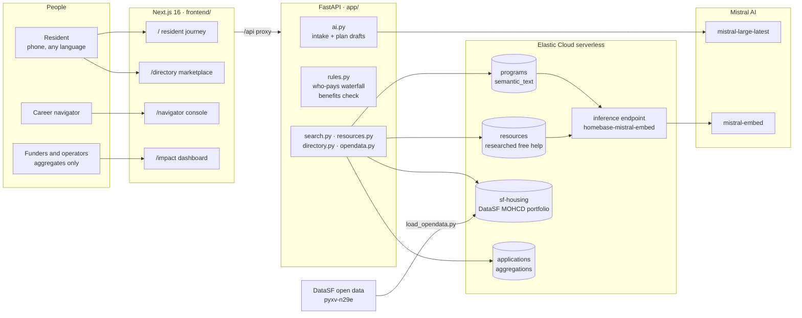
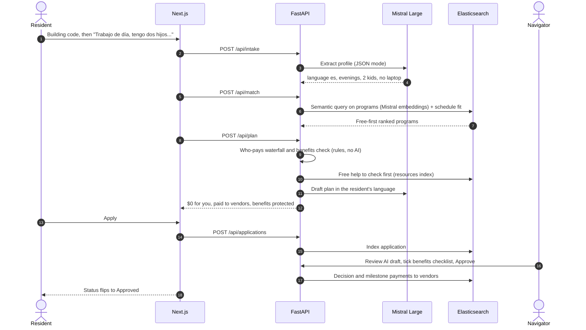
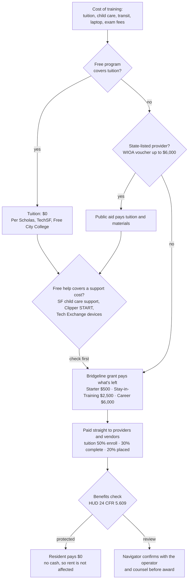
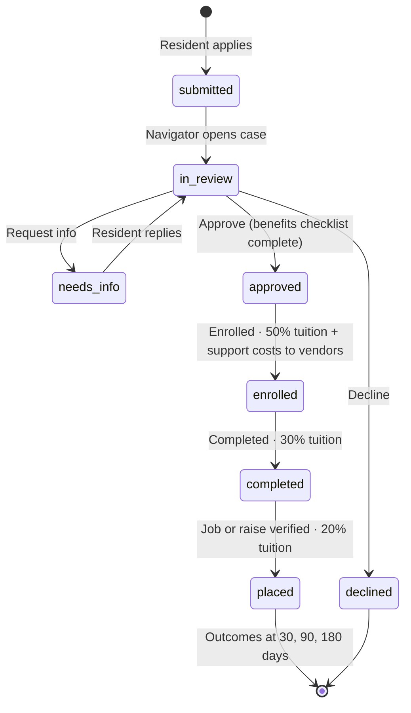
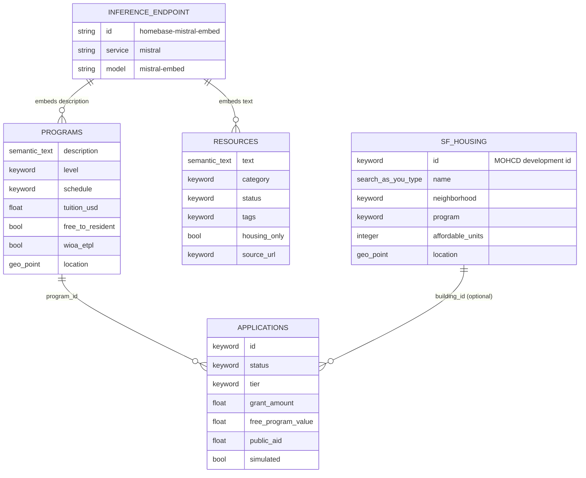
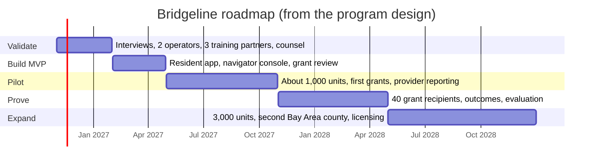

# Bridgeline

**Free tech training for San Francisco affordable-housing residents, with $0 out of pocket and no risk to their rent.**

Built at the Mistral AI x Elastic "Make SF Better" hack night, November 3, 2026.

## The problem

San Francisco's best tech training is already free: Per Scholas, TechSF and Free City College. A parent working days still can't attend, because 12 to 16 weeks of classes means paying for child care, transit and a laptop. Cash help can raise the household's rent, since assisted rents are set by income (HUD, 24 CFR 5.609). DataSF lists **570 affordable rental buildings with 31,981 income-restricted homes**, all aggregated live in Elasticsearch.

## What Bridgeline does

1. **Join:** the resident opens a text-message link and enters their building code, or finds their real building in the DataSF portfolio.
2. **Plan:** they describe their situation in their own words, in English, Spanish, Traditional Chinese, Filipino or Vietnamese. **Mistral Large** turns that into a structured profile.
3. **Match:** **Elasticsearch** runs semantic search over the SF training catalog, using `semantic_text` with **Mistral embeddings** through an inference endpoint. Results are ranked free-first and by schedule fit.
4. **Who pays:** a deterministic waterfall decides who pays for what, in order: the free program, then public aid (WIOA ITA), then the Bridgeline grant. The grant pays child care, transit and device vendors directly. Free city help is checked first: SF child care support, Clipper START and Tech Exchange.
5. **Benefits shield:** every line is checked against HUD income rules. There are no cash stipends, every payment goes to a vendor, and anything the rules don't settle is flagged for counsel and operator review.
6. **Navigator:** a human reviews the plan Mistral drafted. AI never decides eligibility or awards. Approval releases milestone payments: 50% at enrollment, 30% at completion and 20% at placement.
7. **Impact:** funders see aggregates only, as Elastic aggregations: the funnel, dollars leveraged, decision time and cost per outcome.
8. **Directory:** a browsable marketplace of programs, 34 researched free-help resources and the grant tiers.

## Architecture



### The resident journey, end to end



### Who pays, in order



### Application lifecycle



### Elasticsearch data model



### Roadmap



## Run

```bash
cp .env.example .env            # MISTRAL_API_KEY, ES_URL, ES_API_KEY
uv sync
uv run python scripts/setup_elastic.py --reset
uv run python scripts/load_opendata.py --reset
uv run python scripts/load_resources.py --reset
uv run uvicorn app.main:app --port 8010
cd frontend && npm install && echo 'HOMEBASE_API_URL=http://127.0.0.1:8010' > .env.local && npx next dev -p 3000
```
Tests: `uv run pytest -n auto`.

## Honesty notes

- The pilot cohort on the impact page is **simulated** and labelled that way. Applications made in the app are real records.
- The demo properties are fictional. The DataSF buildings and the 34 researched resources are real; each resource links to its source and shows its status as of November 3, 2026.
- Program facts come from public listings. Every card says to confirm details with the provider.
- Benefits treatment is planning guidance, not legal advice.
